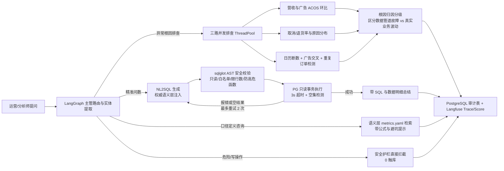

# 跨境电商 NL2SQL 智能问数与经营异常排查 Agent (`ecom-nl2sql-anomaly-agent`)

> 聚焦**跨境宠物电商经营分析与异常排查**场景，面向店铺运营与数据分析师，将自然语言问数、指标口径百科与多维度经营异常根因排查整合为可复核、可防注入、可量化评测的 Agent 平台。

## 架构总览



## 实测量化对比（虚拟机 PostgreSQL `ecom_bi` 10,174 订单 + DeepSeek）

完整评测脚本见 [`evals/run_bi_eval.py`](evals/run_bi_eval.py)，详细报告见 [`evals/reports/v1_vs_v2_bi_report.md`](evals/reports/v1_vs_v2_bi_report.md)。

| 指标维度 | V1 裸 Schema + 串行排查 | V2 语义层 + AST护栏 + 并行 Agent | 提升幅度 |
| :--- | :---: | :---: | :---: |
| **NL2SQL 执行准确率 (EX)** | 50.0% (4/8) | **100.0% (8/8)** | **+50.0 pp** |
| **4 类经营异常根因命中率** | 100.0% (4/4) | **100.0% (4/4)** | 断数/重复/退单/广告全命中 |
| **三路异常排查平均数据库耗时** | 29.8 ms（串行） | **12.0 ms（并行）** | **降延 59.7%** |
| **危险操作/SQL注入拦截率** | 100.0% | **100.0%** | 100% 拦截 |
| **指标口径问答与边界拒答率** | 100.0% | **100.0%** | 零编造口径 |

## 快速启动

```bash
# 1. 初始化 90 天跨境宠物电商仿真数仓（含 4 类注入异常）
.venv/Scripts/python.exe -m ecom_bi.seed_warehouse

# 2. 启动纯中文前端工作台（http://127.0.0.1:8001）
.venv/Scripts/uvicorn.exe ecom_bi.api:app --host 127.0.0.1 --port 8001

# 3. 运行单元测试与 16 题黄金评测集回归
.venv/Scripts/pytest.exe -v
.venv/Scripts/python.exe evals/run_bi_eval.py
```
